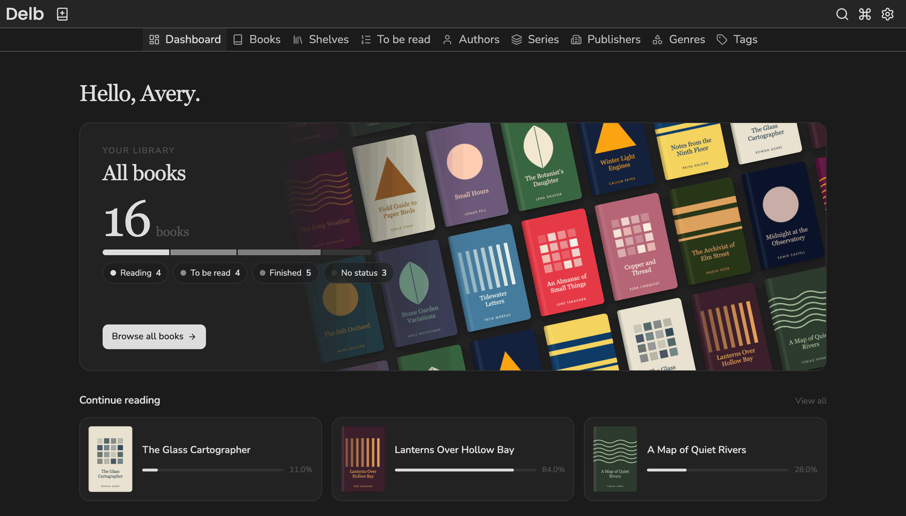

# Delb

Delb is a self-hosted ebook library for your household or a small group. Catalog
your books, read EPUBs and PDFs in your browser, and keep your reading progress,
notes, and shelves private.

[Install with Docker or Unraid](docs/hosting/docker.md) using
`ghcr.io/lancewilhelm/delb:stable`. The image includes the web app and SQLite.

- [Use Delb](docs/README.md#use-delb) to add books, manage access, or connect an agent.
- [Host Delb](docs/hosting/README.md) for configuration, backups, and upgrades.
- [Contribute](CONTRIBUTING.md) to run Delb locally and submit changes.
- [Release notes](https://github.com/lancewilhelm/delb/releases) for changes in each version.

[MIT License](LICENSE)
