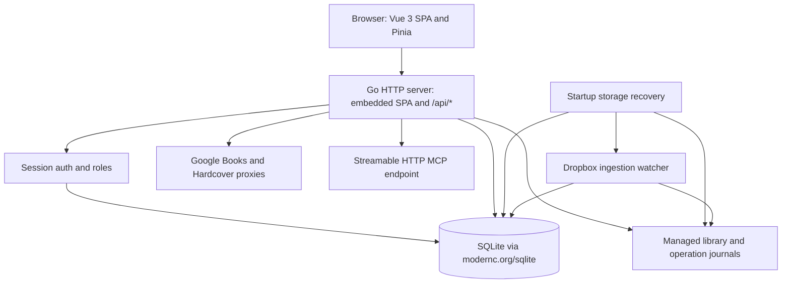

# System architecture

Delb ships as a single static Go binary (`cmd/delb`) that embeds a Vue 3 + Vite single-page app (`app/`, built into `dist/` via `embed_web.go`) and SQLite migrations (`.drizzle/migrations/`, via `embed_migrations.go`). Pinia stores hold client state. Go HTTP handlers use signed session cookies (`internal/auth`), pure-Go SQLite (`modernc.org/sqlite` via `internal/db`), and a managed local library directory (`internal/storage`).

## Runtime responsibilities

| Responsibility            | Implementation                                                                                               | Boundary                                                                      |
| ------------------------- | ------------------------------------------------------------------------------------------------------------ | ----------------------------------------------------------------------------- |
| Routes and interaction    | [Pages](../../app/pages), [components](../../app/components), [composables](../../app/composables)           | Browser SPA interaction and client routing                                    |
| Client state              | [Stores](../../app/stores)                                                                                   | Account settings, filters, selection, and UI preferences                      |
| Sessions and system roles | [Auth handlers](../../internal/auth/handlers.go), [auth store](../../internal/auth/store.go)                 | Signed session cookies, CSRF origin checks, roles, and account administration |
| HTTP router and SPA       | [Router](../../internal/httpapi/router.go), [static SPA](../../internal/httpapi/static.go)                   | Middleware, `/api/*` routing, Vite dev proxy, and embedded SPA serving        |
| Persistent records        | [Migrations](../../.drizzle/migrations), [database connection](../../internal/db/db.go)                      | Pure-Go SQLite (`modernc.org/sqlite`) with WAL mode and startup migrations    |
| Book bytes and covers     | [Book handlers](../../internal/books), [storage operations](../../internal/storage)                          | Filesystem paths, exclusive writes, per-book locks, journals, and recovery    |
| Bookshelves and spines    | [Bookshelf service](../../internal/bookshelf), [spine service](../../internal/spines)                        | Shared and personal bookshelf layouts, shelf pictures, and spine artwork      |
| EPUB cover manipulation   | [EPUB package](../../internal/epub/epub.go)                                                                  | Independent archive inspection and rewriting                                  |
| Imports and agents        | [Goodreads](../../internal/goodreads), [Calibre](../../internal/admin/calibre.go), [MCP](../../internal/mcp) | Goodreads CSV import, Calibre migration, and Streamable HTTP MCP tools        |
| Background ingestion      | [Dropbox watcher](../../internal/dropbox/watcher.go)                                                         | In-process folder watcher started after storage recovery succeeds             |
| Administration and logs   | [Admin service](../../internal/admin), [logging](../../internal/logging)                                     | Health checks, Calibre import, and rotating structured server logs            |

`DATABASE_URL` defaults to `file:./data/delb.db` and supports local SQLite file paths only. `DELB_LIBRARY_DIR` defaults to `library/` relative to the server's working directory.

## Page initialization

The inline [SPA boot script](../../app/utils/spaBootScript.ts) reads cached preferences from `localStorage` and applies theme and font styles synchronously in `<head>` before first paint. In [main.ts](../../app/main.ts), the client runs `initContrast()` and `initFont()`, fetches the active session via `GET /api/auth/get-session` before installing Vue Router, mounts the app, starts `initTheme()`, and pulls account and global settings via [init-sync.ts](../../app/plugins/init-sync.ts).

Pinia persistence keeps supported client preferences in `localStorage` for fast startup, while server rows remain the source of truth for account settings and authorization. The [router](../../app/router.ts) redirects a fresh installation with zero users to `/register` and applies guest and signed-in navigation rules. Each Go API handler still checks its own session and permissions. Hiding a control in the UI never enforces access.

## Three different access questions

Every book belongs to the one shared library. Tag visibility rules decide which books an account can see, through the `visible_books` view. Server roles decide who can change book metadata and files, and who can delete books: Editors, Admins, and the Owner can; Readers cannot. Creator fields record provenance only. Personal status, ratings, reviews, notes, reading position, progress history, TBR queue, and personal Shelves belong to the current reader.

These checks are related but distinct. Seeing a book does not grant a metadata edit, and an edit never shares anyone's reading history. Read the [data model](data-model.md) and [library access reference](reference/library-access.md) before changing those rules.

## Startup and storage consistency

At startup, `storage.StartRecovery` in [recovery.go](../../internal/storage/recovery.go) reconciles interrupted create, cover, move, and delete operations. Its middleware gates incoming requests until recovery completes, and the dropbox watcher waits on the same recovery gate before polling.

File-backed mutations use operation journals and database commit decisions. Per-book SQLite locks under `library/.delb-locks` serialize writers. Database transactions decide whether staged changes committed; filesystem recovery finishes or restores the corresponding bytes. This coordinates two persistence systems without claiming that one atomic transaction covers both.

A busy storage lock can delay recovery and retry. An unrecoverable error stops recovery from completing. See [storage recovery](../hosting/storage-recovery.md) for retained evidence, operator actions, and filesystem limits.

## Feature map

| Area                           | User behavior                                                       | Main source and further reading                                                                                                                                                           |
| ------------------------------ | ------------------------------------------------------------------- | ----------------------------------------------------------------------------------------------------------------------------------------------------------------------------------------- |
| Accounts and dashboard         | Registration, sign-in, totals, status and shelf tiles               | [Auth](../../internal/auth/handlers.go), [dashboard API](../../internal/books/dashboard.go), [dashboard reference](reference/dashboard.md), [account guide](../using/get-started.md)      |
| Add and edit books             | Upload, manual entry, metadata imports, duplicates, replacement     | [Add modal](../../app/components/Books/BookAddModal.vue), [editor](../../app/components/Books/BookEditor.vue), [request flows](core-workflows.md#add-a-book)                              |
| Browse and search              | Entities (including genres), filters, sorting, grid and list fields | [Books page](../../app/pages/books/index.vue), [entity queries](../../internal/books/catalog.go), [search API](../../internal/books/catalog.go)                                           |
| Bookshelves and spines         | Shared library bookshelf, personal Shelves, custom and AI spines    | [BookshelfView](../../app/components/Books/BookshelfView.vue), [bookshelf API](../../internal/bookshelf), [spine service](../../internal/spines)                                          |
| Library access                 | Server roles, tag visibility rules, account management              | [Access checks](../../internal/library/access.go), [tag rule API](../../internal/users/tag_rules.go), [access reference](reference/library-access.md)                                     |
| Reading data and share cards   | EPUB and PDF readers, progress, status, ratings, reviews, notes     | [Reader](../../app/pages/books/[id]/read.vue), [book APIs](../../internal/books), [reading guide](../using/reading.md), [share cards reference](reference/share-cards.md)                 |
| To be read queue               | Private global ordering and rationale shared with book details      | [TBR page](../../app/pages/to-be-read.vue), [queue service](../../internal/books/reading_state.go), [status and rationale reference](reference/reading-status-progress.md)                |
| Settings and appearance        | Profiles, fixed and system themes, custom colors, contrast          | [User settings](../../app/stores/userSettings.ts), [settings reference](reference/settings.md)                                                                                            |
| Metadata providers             | Google Books, Hardcover, server-side cover fetch                    | [Metadata APIs](../../internal/books/books_metadata.go), [metadata reference](reference/metadata.md)                                                                                      |
| Goodreads and Calibre imports  | Goodreads CSV import and one-way Calibre migration                  | [Goodreads](../../internal/goodreads), [Calibre handler](../../internal/admin/calibre.go), [Goodreads guide](../using/import-goodreads.md), [Calibre guide](../hosting/calibre-import.md) |
| Dropbox ingestion              | Poll local input, claim files, ingest, retain failures              | [Dropbox watcher](../../internal/dropbox), [hosting guide](../hosting/README.md#ingestion-and-administration)                                                                             |
| MCP integration                | Per-user bearer tokens and Streamable HTTP MCP tools                | [MCP server](../../internal/mcp), [MCP design](mcp-design.md), [agent guide](../using/connect-an-agent.md)                                                                                |
| Administration and maintenance | Accounts, registration, tokens, health checks, system logs          | [Settings components](../../app/components/Settings), [settings APIs](../../internal/settings), [health reference](../hosting/health-checks.md)                                           |
| Storage and packaging          | Covers, archives, migrations, recovery, container startup           | [Storage recovery](../hosting/storage-recovery.md), [Docker](../hosting/docker.md), [EPUB package](../../internal/epub/epub.go)                                                           |

Tag and genre management are global catalog operations. Admins and the Owner can delete or merge tags and genres through [catalog.go](../../internal/books/catalog.go). These changes update linked books transactionally while keeping the books intact. A tag used by a visibility rule cannot be deleted, and merging moves its rules. Bulk personal-status changes use [books_bulk.go](../../internal/books/books_bulk.go) with explicit visible book IDs.

Disabled sidebar filter controls in [Sidebar.vue](../../app/components/Sidebar.vue) remain placeholders marked **coming soon** and are not active filters.
