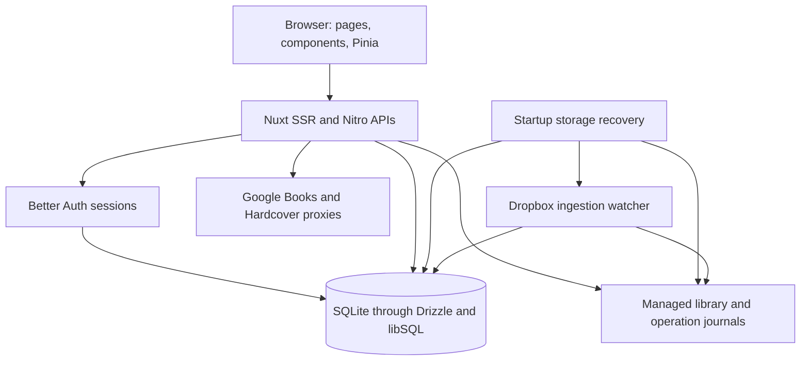

# System architecture

Delb is a Nuxt application with a Vue client, server-rendered pages, and Nitro API handlers in one deployment. Pinia stores own client state. Server handlers use Better Auth sessions, Drizzle queries, and a managed local library directory.

This overview describes the [documented baseline](documentation-status.md). It explains the current code rather than reconstructing undocumented historical design decisions.

## Runtime responsibilities

| Responsibility            | Implementation                                                                                                   | Boundary                                                                       |
| ------------------------- | ---------------------------------------------------------------------------------------------------------------- | ------------------------------------------------------------------------------ |
| Routes and interaction    | [Pages](../../app/pages), [components](../../app/components), [composables](../../app/composables)               | Browser interaction and server rendering                                       |
| Client state              | [Stores](../../app/stores)                                                                                       | Account settings, collection selection, filters, selection, and UI preferences |
| Sessions and system roles | [Auth configuration](../../app/utils/auth.ts), [auth endpoint](../../server/api/auth/[...all].ts)                | Authenticated identity and account administration                              |
| Application requests      | [API handlers](../../server/api)                                                                                 | Input validation, authorization, queries, and mutation coordination            |
| Persistent records        | [Schema](../../app/utils/db/schema.ts), [database connection](../../server/utils/db/cloud.ts)                    | SQLite is the default; the connection uses the libSQL client                   |
| Book bytes and covers     | [Book utilities](../../server/utils/books), [storage operations](../../server/utils/books/storage)               | Filesystem paths, exclusive writes, locks, journals, and recovery              |
| EPUB cover manipulation   | [EPUB package](../../packages/epub/README.md)                                                                    | Independent archive inspection and rewriting                                   |
| Background ingestion      | [Dropbox plugin](../../server/plugins/dropbox-ingest.ts), [watcher](../../server/utils/books/dropbox/watcher.ts) | In-process watcher after recovery succeeds                                     |

The `cloudDb` identifier names the shared Drizzle connection. Its default is `file:./data/delb.db`; the name does not imply a separately hosted database service. Library paths resolve from the server's working directory. An external database URL does not move ebook files to remote storage.

## Page initialization

The [server auth plugin](../../app/plugins/auth.server.ts) fetches the session for a normal server-rendered request. The [settings preload plugin](../../app/plugins/00-settings-ssr.server.ts) fetches account/global settings with the request cookie. Theme and font plugins add the corresponding resources to the response.

The browser hydrates that state. Client auth handles non-SSR and cached-page cases. The [sync plugin](../../app/plugins/sync.client.ts) pulls settings after sign-in and mounting. Pinia persistence stores supported state in localStorage; it does not replace server authorization or durable account settings.

The [route middleware](../../app/middleware/auth.global.ts) sends a fresh installation to registration and applies guest/user navigation rules. Each API handler still checks its own session and permissions. A hidden button is not an authorization rule.

## Three different ownership questions

A collection membership makes books visible. A collection owner or editor can manage membership in that collection. A book's creator or a system administrator controls privileged metadata/file mutations. Personal status, ratings, position, and progress belong to the current reader.

These checks are related but distinct. Sharing a collection does not create a private copy of a book, grant every metadata edit, or share the owner's reading history. Read the [data model](data-model.md) and [access reference](reference/collections.md) before changing those rules.

## Startup and storage consistency

The [recovery promise](../../server/utils/books/storage/recovery-ready.ts) reconciles create, cover, move, and delete operations. [Server middleware](../../server/middleware/storage-recovery.ts) waits for it before handling requests. The Dropbox plugin also waits before starting ingestion.

File-backed mutations use operation journals and database commit decisions. Per-book SQLite locks coordinate writers. Database transactions decide whether staged changes committed; filesystem recovery finishes or restores the corresponding bytes. This coordinates two persistence systems without claiming one atomic transaction covers both.

A busy storage lock can delay recovery and retry. An unrecoverable error prevents the recovery promise from resolving successfully. See [storage recovery](../hosting/storage-recovery.md) for retained evidence, operator actions, and filesystem limits.

## Feature map

| Area                           | User behavior                                                   | Main source and further reading                                                                                                                                                    |
| ------------------------------ | --------------------------------------------------------------- | ---------------------------------------------------------------------------------------------------------------------------------------------------------------------------------- |
| Accounts and dashboard         | Registration, login, totals, reading shelves                    | [Auth](../../app/utils/auth.ts), [dashboard API](../../server/api/dashboard/index.get.ts), [dashboard reference](reference/dashboard.md), [account guide](../using/get-started.md) |
| Add and edit books             | Upload, manual entry, metadata imports, duplicates, replacement | [Add modal](../../app/components/Books/BookAddModal.vue), [editor](../../app/components/Books/BookEditor.vue), [request flows](core-workflows.md#add-a-book)                       |
| Browse and search              | Collection scope, entities, filters, sorting, grid/list fields  | [Books page](../../app/pages/books/index.vue), [entity queries](../../server/utils/books/entity-list-query.ts), [search API](../../server/api/search/index.get.ts)                 |
| Collections and sharing        | Membership, roles, transfer, leave, deletion                    | [Collection store](../../app/stores/collections.ts), [collection APIs](../../server/api/collections), [access reference](reference/collections.md)                                 |
| Reading data                   | EPUB location, progress history, status, dates, ratings         | [Reader](../../app/pages/books/[id]/read.vue), [book APIs](../../server/api/books), [reading guide](../using/reading.md)                                                           |
| To be read queue               | Private global ordering and rationale shared with book details  | [TBR page](../../app/pages/to-be-read.vue), [queue service](../../server/utils/books/tbr.ts), [status and rationale reference](reference/reading-status-progress.md)               |
| Settings and appearance        | Desktop/mobile profiles, fixed/system themes, custom colors     | [User settings](../../app/stores/userSettings.ts), [settings explanation](reference/settings.md)                                                                                   |
| Metadata providers             | Google Books, Hardcover, server-side cover fetch                | [Metadata APIs](../../server/api/books/metadata), [metadata reference](reference/metadata.md)                                                                                      |
| Dropbox ingestion              | Poll local input, claim files, ingest, retain failures          | [Dropbox utilities](../../server/utils/books/dropbox), [hosting guide](../hosting/README.md#ingestion-and-administration)                                                          |
| Calibre import                 | Read metadata DB and copy supported formats into Delb           | [Import handler](../../server/api/settings/admin/calibre.post.ts), [import guide](../hosting/calibre-import.md)                                                                    |
| Administration and maintenance | Accounts, registration, tokens, quick/deep health checks        | [Settings components](../../app/components/Settings), [settings APIs](../../server/api/settings), [health reference](../hosting/health-checks.md)                                  |
| Storage and packaging          | Covers, archives, migrations, recovery, container startup       | [Storage recovery](../hosting/storage-recovery.md), [Docker](../hosting/docker.md), [EPUB package](../../packages/epub/README.md)                                                  |

Tag management is a global catalog operation. System admins and owners can delete or merge tags through the [tag APIs](../../server/api/tags) and [transactional mutation utility](../../server/utils/tags/mutate.ts). The change affects linked books across collections and preserves the books themselves. Bulk personal-status changes use the [bulk status endpoint](../../server/api/books/bulk/status.post.ts) with explicit visible book IDs.

Schema presence alone does not establish a finished UI feature. For example, the schema includes book notes, while the first documentation release does not claim a complete notes workflow. Disabled sidebar filters remain identified as planned controls.
