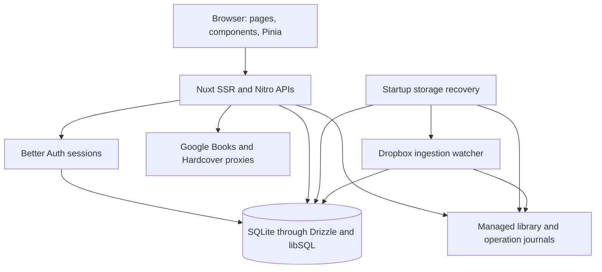

# System architecture

Delb is a Nuxt application with a Vue client, server-rendered pages, and Nitro API handlers in one deployment. Pinia stores own client state. Server handlers use Better Auth sessions, Drizzle queries, and a managed local library directory.

This overview describes the [documented baseline](documentation-status.md). It explains the current code rather than reconstructing undocumented historical design decisions.

## Runtime responsibilities

| Responsibility            | Implementation                                                                                                   | Boundary                                                                       |
| ------------------------- | ---------------------------------------------------------------------------------------------------------------- | ------------------------------------------------------------------------------ |
| Routes and interaction    | [Pages](../../app/pages), [components](../../app/components), [composables](../../app/composables)               | Browser SPA interaction and client routing                                     |
| Client state              | [Stores](../../app/stores)                                                                                       | Account settings, collection selection, filters, selection, and UI preferences |
| Sessions and system roles | [Auth configuration](../../internal/auth/handlers.go), [auth endpoint](../../internal/auth/handlers.go)             | Authenticated identity and account administration                              |
| Application requests      | [API handlers](../../internal/httpapi/router.go)                                                                                 | Input validation, authorization, queries, and mutation coordination            |
| Persistent records        | [Schema](../../.drizzle/migrations), [database connection](../../internal/db/db.go)                 | SQLite is the default; the connection uses the libSQL client                   |
| Book bytes and covers     | [Book utilities](../../internal/books), [storage operations](../../internal/storage)               | Filesystem paths, exclusive writes, locks, journals, and recovery              |
| EPUB cover manipulation   | [EPUB package](../../internal/epub/epub.go)                                                                    | Independent archive inspection and rewriting                                   |
| Background ingestion      | [Dropbox plugin](../../internal/dropbox/watcher.go), [watcher](../../internal/dropbox/watcher.go) | In-process watcher after recovery succeeds                                     |

The `cloudDb` identifier names the shared Drizzle connection. Its default is `file:./data/delb.db`; the name does not imply a separately hosted database service. Library paths resolve from the server's working directory. An external database URL does not move ebook files to remote storage.

## Page initialization

The inline [SPA boot script](../../app/utils/spaBootScript.ts) applies persisted theme and font preferences from `localStorage` synchronously in `<head>` before first paint. The [client auth plugin](../../app/main.ts) fetches the active session via `/api/auth/get-session` before route guards run, and the [sync plugin](../../app/plugins/init-sync.ts) pulls account and global settings once authenticated.

The browser hydrates that state. Client auth handles non-SSR and cached-page cases. The [sync plugin](../../app/plugins/init-sync.ts) pulls settings after sign-in and mounting. Pinia persistence stores supported state in localStorage; it does not replace server authorization or durable account settings.

The [route middleware](../../app/router.ts) sends a fresh installation to registration and applies guest/user navigation rules. Each API handler still checks its own session and permissions. A hidden button is not an authorization rule.

## Three different ownership questions

A book belongs to one collection. Its membership makes books visible, and collection owner/editor roles govern book metadata, files, deletion, and moves. Creator is provenance. Administrators can manage collection membership and ownership without joining. Personal status, ratings, position, and progress belong to the current reader.

These checks are related but distinct. Sharing a collection does not create a private copy of a book, grant every metadata edit, or share the owner's reading history. Read the [data model](data-model.md) and [access reference](reference/collections.md) before changing those rules.

## Startup and storage consistency

The [recovery promise](../../internal/storage/recovery.go) reconciles create, cover, move, and delete operations. [Server middleware](../../internal/storage/recovery.go) waits for it before handling requests. The Dropbox plugin also waits before starting ingestion.

File-backed mutations use operation journals and database commit decisions. Per-book SQLite locks coordinate writers. Database transactions decide whether staged changes committed; filesystem recovery finishes or restores the corresponding bytes. This coordinates two persistence systems without claiming one atomic transaction covers both.

A busy storage lock can delay recovery and retry. An unrecoverable error prevents the recovery promise from resolving successfully. See [storage recovery](../hosting/storage-recovery.md) for retained evidence, operator actions, and filesystem limits.

## Feature map

| Area                           | User behavior                                                    | Main source and further reading                                                                                                                                                    |
| ------------------------------ | ---------------------------------------------------------------- | ---------------------------------------------------------------------------------------------------------------------------------------------------------------------------------- |
| Accounts and dashboard         | Registration, login, totals, reading shelves                     | [Auth](../../internal/auth/handlers.go), [dashboard API](../../internal/books/reading_state.go), [dashboard reference](reference/dashboard.md), [account guide](../using/get-started.md) |
| Add and edit books             | Upload, manual entry, metadata imports, duplicates, replacement  | [Add modal](../../app/components/Books/BookAddModal.vue), [editor](../../app/components/Books/BookEditor.vue), [request flows](core-workflows.md#add-a-book)                       |
| Browse and search              | Collection scope, entities, filters, sorting, grid/list fields   | [Books page](../../app/pages/books/index.vue), [entity queries](../../internal/books/catalog.go), [search API](../../internal/books/catalog.go)                 |
| Collections and sharing        | Membership, roles, transfer, leave, deletion                     | [Collection store](../../app/stores/collections.ts), [collection APIs](../../internal/collections), [access reference](reference/collections.md)                                 |
| Reading data                   | EPUB/PDF position, progress history, status, dates, ratings      | [Reader](../../app/pages/books/[id]/read.vue), [book APIs](../../internal/books), [reading guide](../using/reading.md)                                                           |
| To be read queue               | Private global ordering and rationale shared with book details   | [TBR page](../../app/pages/to-be-read.vue), [queue service](../../internal/books/reading_state.go), [status and rationale reference](reference/reading-status-progress.md)               |
| Settings and appearance        | Profiles, fixed/system themes, custom colors, interface contrast | [User settings](../../app/stores/userSettings.ts), [settings explanation](reference/settings.md)                                                                                   |
| Metadata providers             | Google Books, Hardcover, server-side cover fetch                 | [Metadata APIs](../../internal/books/books_metadata.go), [metadata reference](reference/metadata.md)                                                                                      |
| Dropbox ingestion              | Poll local input, claim files, ingest, retain failures           | [Dropbox utilities](../../internal/dropbox), [hosting guide](../hosting/README.md#ingestion-and-administration)                                                          |
| Calibre import                 | Read metadata DB and copy supported formats into Delb            | [Import handler](../../internal/admin/calibre.go), [import guide](../hosting/calibre-import.md)                                                                    |
| Administration and maintenance | Accounts, registration, tokens, quick/deep health checks         | [Settings components](../../app/components/Settings), [settings APIs](../../internal/settings), [health reference](../hosting/health-checks.md)                                  |
| Storage and packaging          | Covers, archives, migrations, recovery, container startup        | [Storage recovery](../hosting/storage-recovery.md), [Docker](../hosting/docker.md), [EPUB package](../../internal/epub/epub.go)                                                  |

Tag management is a global catalog operation. System admins and owners can delete or merge tags through the [tag APIs](../../internal/books/catalog.go) and [transactional mutation utility](../../internal/books/catalog.go). The change affects linked books across collections and preserves the books themselves. Bulk personal-status changes use the [bulk status endpoint](../../internal/books/reading_state.go) with explicit visible book IDs.

Schema presence alone does not establish a finished UI feature. For example, the schema includes book notes, while the first documentation release does not claim a complete notes workflow. Disabled sidebar filters remain identified as planned controls.
