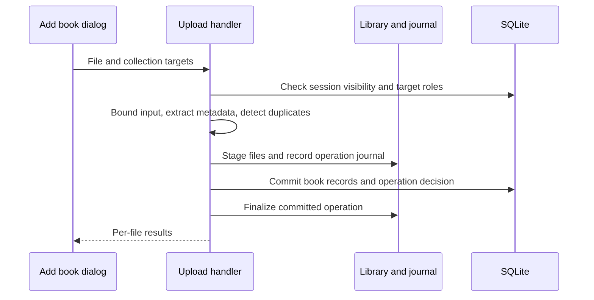

# Core request flows

These flows connect the [user guides](../README.md#use-delb) to the implementation. Source inspection establishes the described paths. The [verification record](documentation-status.md) states which paths were exercised in the demo.

## Account initialization

The [registration page](../../app/pages/register.vue) validates fields and calls Better Auth email signup. The [auth configuration](../../app/utils/auth.ts) permits the first registration, applies the later registration toggle, and restricts self-registration to the normal user role.

After user creation, auth creates a Personal collection and owner membership. [Owner bootstrap](../../server/utils/security/bootstrap.ts) claims a durable `system_state` marker and promotes a user in the same database transaction. Session creation also ensures a Personal collection exists for accounts created through other supported paths.

The page fetches the new session and pulls user/global settings before navigation. Route middleware controls navigation; API authorization remains server-side.

## Add a book

The [Add book modal](../../app/components/Books/BookAddModal.vue) loads target collections, keeps Personal selected, and dispatches one of three paths.

| Path     | Request                                                                                        | Database and file effects                                                                                                   |
| -------- | ---------------------------------------------------------------------------------------------- | --------------------------------------------------------------------------------------------------------------------------- |
| Upload   | `POST /api/books/upload`, multipart `file` and repeated `collectionId` fields                  | Extract metadata, review duplicates, coordinate stored-file creation/replacement, write book/file/author/collection records |
| Metadata | `POST /api/books/metadata-import/create`, selected provider record or query and collection IDs | Resolve shared entities, create/link book metadata, optionally store a cover; no ebook download                             |
| Manual   | `POST /api/books` from the blank editor                                                        | Validate title/authors, resolve shared entities, and write book/collection records without an ebook file                    |

Each handler checks the session and target collection roles. The UI's Personal selection is distinct from the API's fallback behavior: these endpoints resolve Personal when no explicit target list is supplied. Do not assume every external API caller includes Personal in an explicit list.

### Upload coordination

The [upload handler](../../server/api/books/upload.post.ts) uses [stored-create operations](../../server/utils/books/storage/create-operation.ts) and database decisions to coordinate files and rows. A replacement also uses the per-book lock and preserves the existing book identity. User reading records attached to that identity remain distinct from replaced content.

Batch results require per-file inspection. Duplicate review can stop an individual import and request an explicit decision. Metadata replacement requires a system administrator/owner and updates the existing catalog record. Linking an existing duplicate to a collection creates membership links instead of another book.

The [manual handler](../../server/api/books/index.post.ts), [metadata handler](../../server/api/books/metadata-import/create.post.ts), and upload handler have different sequencing. Do not infer that all creation paths use the same database transaction or storage journal. Metadata cover fetches and canonical-directory work include best-effort steps after record creation.

## Browse and search

The header's [collection store](../../app/stores/collections.ts) holds either All or a concrete collection selection. The [Books page](../../app/pages/books/index.vue) combines it with filters, sort settings, and view preferences. Grid/list components request pages and render the visible portion of the list.

[Book listing](../../server/api/books/index.get.ts) first resolves the authenticated reader's collection memberships. A selected collection must belong to that set. Status filters join the reader's personal status records. Stable sort keys and cursors keep pagination consistent for a chosen ordering. The response enriches the page with the metadata selected by book views.

[Entity list queries](../../server/utils/books/entity-list-query.ts) serve book lists under authors, publishers, and tags. [Global search](../../server/api/search/index.get.ts) searches across accessible records, including stored identifiers. Its visibility scope is not an automatic copy of every Books-page filter.

Tag deletion and merging require system admin/owner authorization. They mutate shared catalog links across collections in a transaction and preserve book records. The selected collection does not limit the global effect.

Changing a view field updates account settings, not the book's metadata. The virtualized UI and cursor-paginated API solve different problems: the client limits rendered elements; the server limits requested records.

## Collections and sharing

Creating a [collection](../../server/api/collections/index.post.ts) establishes the owner relation. [Member upsert](../../server/api/collections/[id]/members/index.put.ts) resolves an existing account by email and accepts editor/viewer roles. It does not deliver an email invitation.

The [single-book collection handler](../../server/api/books/[id]/collections/index.put.ts) checks book visibility and target edit rights in its transaction. It reports forbidden targets and ignored Personal removals. The [bulk handler](../../server/api/collections/[id]/books/bulk.post.ts) additionally requires an editable source collection and resolves selection inside that scope.

Ownership transfer establishes one owner and demotes the old owner to editor. Leave removes a non-owner membership. Collection deletion removes collection links, not book records. Book deletion is separate and invokes [book deletion](../../server/utils/books/delete-book.ts), including creator/admin authorization and storage coordination.

The [collection settings dialog](../../app/components/Collections/EditCollectionModal.vue) handles member loading, immediate access saves, errors, focus, and separate confirmation states for consequential actions. Read the [permissions reference](../collections-sharing-rbac.md) for the role matrix.

## Reading and personal data

The [book detail page](../../app/pages/books/[id]/index.vue) loads metadata/files and the current user's status and preferences. The Read action depends on an EPUB file. The [reader page](../../app/pages/books/[id]/read.vue) fetches that file through the authorized download endpoint and restores the saved position.

Relocation sends `PUT /api/books/:id/reading-position`. The request can include `clientSessionId` and an increasing `clientSequence`. [Position persistence](../../server/utils/books/save-position.ts) ignores older sequence writes from the same reader session. This is not a global conflict-resolution protocol between devices; a different reader session is accepted independently.

Progress-history sync is opt-in per user/book. Position updates can append reader-sourced progress entries when enabled. On open, the enabled reader can also restore from the latest logged percentage after EPUB locations finish generating, provided the user has not already navigated. Manual progress logs and Finished status create their own entries. A historical percentage remains a separate record from an EPUB location even when this restoration converts between them.

[Status transitions](../../server/utils/books/status-transition.ts) apply date and To be read ordering rules. The [bulk status endpoint](../../server/api/books/bulk/status.post.ts) accepts explicit book IDs and applies the current user's status only to visible records. It does not accept all-in-scope selection semantics. Personal ratings use a user/book record with a half-star integer value. Sharing the book leaves each user's records separate.

## Settings and background work

[Settings persistence](../settings.md) explains acknowledgement revisions, stale responses, retries, and server-rendered theme selection. UI persistence does not grant access to global settings.

The Dropbox watcher waits for [storage recovery](../storage-recovery.md), polls local input, claims supported files, and ingests them into configured targets. Failed files and error sidecars remain available for investigation. [Calibre import](../calibre-import.md) is an administrator-triggered request flow rather than the Dropbox watcher.

External metadata and image requests stay in server handlers. The [metadata reference](../metadata-fetcher.md) describes token availability, result mapping, and cover normalization. The [hosting guide](../hosting/README.md) connects the operational configuration.
