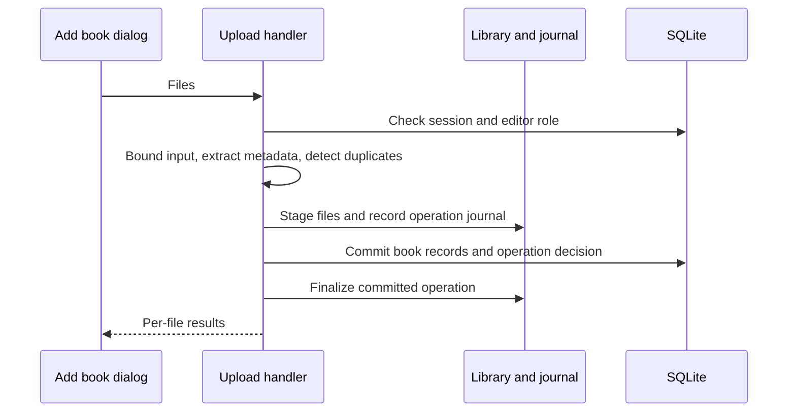

# Core request flows

These flows connect the [user guides](../README.md#use-delb) to the implementation. Source inspection establishes the described paths. The [verification record](documentation-status.md) states which paths were exercised in the demo.

## Account initialization

The [registration page](../../app/pages/register.vue) validates fields and calls Better Auth email signup. The [auth configuration](../../internal/auth/handlers.go) permits the first registration, applies the later registration toggle, and restricts self-registration to the normal user role.

After user creation, [owner bootstrap](../../internal/auth/handlers.go) claims its durable marker, initializes the shared Default when needed, and enrolls the new user in one transaction. Later users join the current default as editors. Session creation does not enroll users again.

The page fetches the new session and pulls user/global settings before navigation. Route middleware controls navigation; API authorization remains server-side.

## Add a book

The [Add book modal](../../app/components/Books/BookAddModal.vue) is available to Editors and Admins and dispatches one of three paths.

| Path     | Request                                                                     | Database and file effects                                                                                        |
| -------- | --------------------------------------------------------------------------- | ---------------------------------------------------------------------------------------------------------------- |
| Upload   | `POST /api/books/upload`, multipart files                                   | Extract metadata, review duplicates, coordinate stored-file creation/replacement, write book/file/author records |
| Metadata | `POST /api/books/metadata-import/create`, selected provider record or query | Resolve shared entities, create book metadata, optionally store a cover; no ebook download                       |
| Manual   | `POST /api/books` from the blank editor                                     | Validate title/authors, resolve shared entities, and write book records without an ebook file                    |

Each creation handler requires the Editor or Admin role, and the final database write rechecks it. Every new book goes into the library.

### Upload coordination

The [upload handler](../../internal/books/books_files.go) uses [stored-create operations](../../internal/storage/create.go) and database decisions to coordinate files and rows. A replacement also uses the per-book lock and preserves the existing book identity. User reading records attached to that identity remain distinct from replaced content.

Batch results require per-file inspection. Duplicate review can stop an individual import and request an explicit decision. Replacement requires the Editor or Admin role and a visible existing entry. A visible match can also be reused, or the import can create an independent entry or cancel.

The [manual handler](../../internal/books/books_crud.go), [metadata handler](../../internal/books/books_metadata.go), and upload handler have different sequencing. Do not infer that all creation paths use the same database transaction or storage journal. Metadata cover fetches and canonical-directory work include best-effort steps after record creation.

## Browse and search

The [Books page](../../app/pages/books/index.vue) combines filters, sort settings, and view preferences. Grid/list components request pages and render the visible portion of the list.

The dashboard's **Browse all books** link calls the [Books filter store](../../app/stores/booksIndexFilters.ts) to clear its persisted status, date-added, and file-presence filters before navigation. Sort settings and view preferences remain unchanged. Dashboard status links open the Books view with their status query parameters. The **To be read** tile opens the dedicated personal queue.

The [dashboard overview query](../../internal/books/dashboard.go) counts the books that the reader can see (including **To be read**), lists the most recently added books, previews each status list, and picks random samples for Pile art. Continue reading uses the reader's saved progress. Finished uses the reader's finish dates. Tag visibility rules apply to counts and every list. [The dashboard reference](reference/dashboard.md) describes the request, order, and card art rules.

[Book listing](../../internal/books/books_crud.go) joins the `visible_books` view for the authenticated reader. Status filters join the reader's personal status records. Stable sort keys and cursors keep pagination consistent for a chosen ordering. The response enriches the page with the metadata selected by book views.

[Entity list queries](../../internal/books/catalog.go) serve book lists under authors, publishers, and tags. [Global search](../../internal/books/catalog.go) searches across visible records, including stored identifiers. Its visibility scope is not an automatic copy of every Books-page filter.

Tag deletion and merging require system admin/owner authorization. They mutate shared catalog links in a transaction and preserve book records. Deletion is refused while a tag visibility rule uses the tag, and merging moves the rules to the destination tag.

Changing a view field updates account settings, not the book's metadata. The virtualized UI and cursor-paginated API solve different problems: the client limits rendered elements; the server limits requested records.

## Accounts, roles, and tag rules

The first account becomes the Owner. Later accounts are Readers until an Admin changes their role through the [admin user endpoints](../../internal/auth/handlers.go). Admins edit an Editor's or Reader's [tag visibility rules](../../internal/users/tag_rules.go) in the same user editor. Rule changes take effect on the account's next request because every query joins `visible_books`. Account deletion keeps the books that the account added; their provenance columns become null.

Book deletion uses [the editor role check and storage coordination](../../internal/storage/delete.go). Read the [library access reference](reference/library-access.md) for the role matrix.

## Reading and personal data

The [book detail page](../../app/pages/books/[id]/index.vue) loads metadata/files and the current user's status and preferences. Read supports EPUB and PDF, preferring EPUB when both exist. Read PDF explicitly selects a PDF alongside an EPUB. The [reader page](../../app/pages/books/[id]/read.vue) fetches the selected file through the authorized download endpoint and restores the saved position. The [PDF reference](reference/pdf-reader.md) describes its canvas rendering and page-based locations.

Relocation sends `PUT /api/books/:id/reading-position`. The request can include `clientSessionId` and an increasing `clientSequence`. [Position persistence](../../internal/books/reading_state.go) ignores older sequence writes from the same reader session. This is not a global conflict-resolution protocol between devices; a different reader session is accepted independently.

Progress-history sync is opt-in per user/book. Position updates can append reader-sourced progress entries when enabled. On open, the enabled reader can also restore from the latest logged percentage after EPUB locations finish generating, provided the user has not already navigated. Manual progress logs and Finished status create their own entries. A historical percentage remains a separate record from an EPUB location even when this restoration converts between them.

Grid cards, list covers, and dashboard Continue reading covers expose **Reading status** in their context menu. The [shared status menu](../../app/composables/useBookReadingStatusMenu.ts) reads `GET /api/books/:id/status` whenever the menu opens and saves a choice with `POST` to the same endpoint. Successful saves emit the saved book ID and status. The containing view updates that loaded record in place, or removes it if it no longer matches the status filter. Loaded pages, pagination cursors, and scroll position are retained. The dashboard reloads its overview when a Continue reading book changes status. Failed saves keep the menu open for retry. Existing View and Download actions remain available, and bulk selection mode disables the cover menu.

[Status transitions](../../internal/books/reading_state.go) apply date and To be read ordering rules. The [bulk status endpoint](../../internal/books/reading_state.go) accepts explicit book IDs and applies the current user's status only to visible records. It does not accept all-in-scope selection semantics. Personal ratings use a user/book record with a half-star integer value. Sharing the book leaves each user's records separate.

## Settings and background work

[Settings persistence](reference/settings.md) explains acknowledgement revisions, stale responses, retries, and server-rendered theme selection. UI persistence does not grant access to global settings.

The Dropbox watcher waits for [storage recovery](../hosting/storage-recovery.md), polls local input, claims supported files, and ingests them into configured targets. Failed files and error sidecars remain available for investigation. [Calibre import](../hosting/calibre-import.md) is an administrator-triggered request flow rather than the Dropbox watcher.

External metadata and image requests stay in server handlers. The [metadata reference](reference/metadata.md) describes token availability, result mapping, and cover normalization. The [hosting guide](../hosting/README.md) connects the operational configuration.
