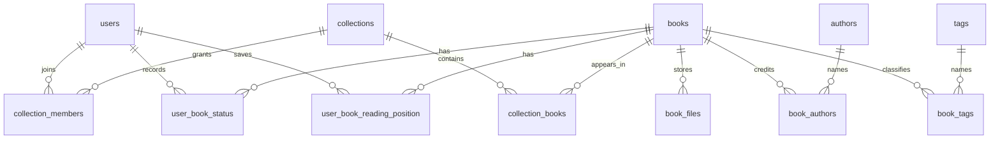

# Delb's data model

The [Drizzle schema](../../app/utils/db/schema.ts) describes Delb's own database. [SQL migrations](../../.drizzle/migrations) define upgrades. The separate [Calibre schema reference](../calibre-database-schema.md) describes an import source, not Delb's tables.

## Shared catalog and collection access

`books` holds shared metadata, including title, description, publication fields, page count, publisher, series, cover pointer, and optional creator/import provenance. Its author, tag, identifier, and file records are separate tables.

`collections` defines named scopes. `collection_members` grants a user an owner, editor, or viewer role. `collection_books` associates an existing book with a collection. The unique collection/book pair prevents duplicate membership links.

A reader sees a book through at least one collection membership. Two collections containing the same book refer to the same catalog metadata and files. They do not hold independent copies.

The Personal flag identifies a user's default collection independently of its displayed name. Auth hooks create and backfill Personal collections. The schema indexes owner/Personal lookups; the one-Personal-per-user rule also depends on application logic.

`created_by_user_id` records creator provenance and participates in book mutation authorization. It can be null for legacy/imported records or after user deletion. It is not the collection access relation.

## Records scoped to a reader

| Table                        | Scope and purpose                                                                |
| ---------------------------- | -------------------------------------------------------------------------------- |
| `user_book_status`           | One user/book status with start, finish, DNF dates, and optional To be read rank |
| `user_book_reading_position` | One user/book location, progress, and reader-session sequence                    |
| `user_book_preferences`      | User/book options, including reader-to-history progress sync                     |
| `user_book_progress_log`     | Historical entries with source, percentage, optional page, and occurrence date   |
| `book_ratings`               | One user/book rating on the integer half-star scale, 1 through 10                |
| `book_notes`                 | User/book note records in the schema; not evidence of a complete notes interface |

The same shared book can have different statuses, positions, ratings, and history for different users. Current endpoints select the authenticated user's records.

## Accounts and settings

Better Auth uses `users`, `sessions`, `accounts`, and `verifications`. System roles are distinct from collection roles.

`user_settings` stores a JSON account document and a millisecond revision timestamp. That document includes desktop settings and an optional mobile override profile. `global_settings` stores installation-wide settings. `global_secrets` stores server-side credentials such as the Hardcover token; settings responses expose availability rather than the token.

`system_state` records completed initialization such as the owner-bootstrap claim. Avoid interpreting an empty user list as permission to rewrite that durable bootstrap history.

## Files and operation decisions

`book_files` stores file format, relative path, and file metadata. Bytes live under `library/`. Cover files can exist even when the book has no downloadable ebook.

`storage_operations` stores durable operation decisions alongside the database mutation. Filesystem journals preserve the associated staged/original paths. Operation IDs connect the database decision to recovery work. These records and `.delb-*` directories are part of consistency handling, not disposable caches.

Read [storage recovery](../storage-recovery.md) before changing file deletion or cleanup. Back up the database and library together.

## Useful constraints

| Constraint                                                | Effect                                                                                |
| --------------------------------------------------------- | ------------------------------------------------------------------------------------- |
| Unique user email                                         | Collection member lookup identifies an existing account                               |
| Unique collection/user membership                         | A member has one role in a collection                                                 |
| Partial unique collection owner                           | At most one owner membership per collection                                           |
| Unique collection/book pair                               | Repeated adds do not create duplicate links                                           |
| Unique non-null Calibre book ID                           | Calibre re-import can identify an existing Delb book                                  |
| Unique user/book status, position, preference, and rating | Personal values remain separate across readers                                        |
| Unique book/identifier type                               | An identifier type has one value per book; cross-book duplicates still need detection |

Foreign-key cascades and explicit mutation logic remove related rows. They do not automatically remove ebook bytes. File deletion requires the storage operation path.
