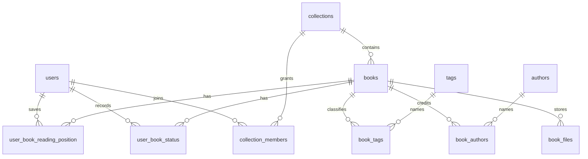

# Delb's data model

The [Drizzle schema](../../app/utils/db/schema.ts) describes Delb's own database. [SQL migrations](../../.drizzle/migrations) define upgrades. The separate [Calibre schema reference](reference/calibre-schema.md) describes an import source, not Delb's tables.

## Shared catalog and collection access

`books` holds shared metadata, including title, description, publication fields, page count, publisher, series, cover pointer, and optional creator/import provenance. Its author, tag, identifier, and file records are separate tables.

`collections` defines named scopes, with one `is_default` designation. Every collection has an owner, synchronized with its required owner membership. `collection_members` grants owner, editor, or viewer access.

Each `books.collection_id` identifies one collection. `collection_books` is a read-only projection for collection queries, with no independent membership state. Separate entries can represent the same title and retain independent files and reading data.

Owner/editor membership governs book mutations. `created_by_user_id` is provenance. SQL guards protect required collection assignment and ownership through creation, transfer, leaving, deletion, and concurrent requests.

Legacy `is_personal` values and `legacy_collection_books` provide the source for a staged [administrative migration](../hosting/collection-migration.md). Normal library traffic pauses until the retained plan commits. The migration preserves private memberships, splits entries and files, and enrolls existing users into a new shared default once.

## Records scoped to a reader

| Table                        | Scope and purpose                                                                      |
| ---------------------------- | -------------------------------------------------------------------------------------- |
| `user_book_status`           | One user/book status with start, finish, DNF dates, and optional To be read rank       |
| `user_book_reading_position` | One user/book location, progress, and reader-session sequence                          |
| `user_book_preferences`      | User/book options, including reader-to-history progress sync                           |
| `user_book_progress_log`     | Historical entries with source, percentage, optional page, and occurrence date         |
| `book_ratings`               | One user/book rating on the integer half-star scale, 1 through 10                      |
| `user_book_rationale`        | One private plain-text TBR rationale per reader/book, retained independently of status |
| `book_notes`                 | User/book note records in the schema; not evidence of a complete notes interface       |

The same shared book can have different statuses, positions, ratings, rationale, and history for different users. Current endpoints select the authenticated user's records.

## Accounts and settings

Better Auth uses `users`, `sessions`, `accounts`, and `verifications`. System roles are distinct from collection roles.

`user_settings` stores a JSON account document and a millisecond revision timestamp. That document includes desktop settings and an optional mobile override profile. `global_settings` stores installation-wide settings. `global_secrets` stores server-side credentials such as the Hardcover token; settings responses expose availability rather than the token.

`system_state` records completed initialization such as the owner-bootstrap claim. Avoid interpreting an empty user list as permission to rewrite that durable bootstrap history.

## Files and operation decisions

`book_files` stores file format, relative path, and file metadata. Bytes live under `library/`. Cover files can exist even when the book has no downloadable ebook.

`storage_operations` stores durable operation decisions alongside the database mutation. Filesystem journals preserve the associated staged/original paths. Operation IDs connect the database decision to recovery work. These records and `.delb-*` directories are part of consistency handling, not disposable caches.

Read [storage recovery](../hosting/storage-recovery.md) before changing file deletion or cleanup. Back up the database and library together.

## Useful constraints

| Constraint                                                           | Effect                                                                                |
| -------------------------------------------------------------------- | ------------------------------------------------------------------------------------- |
| Unique user email                                                    | Collection member lookup identifies an existing account                               |
| Unique collection/user membership                                    | A member has one role in a collection                                                 |
| Owner index and lifecycle triggers                                   | Exactly one owner matching the collection owner                                       |
| Required book collection and read-only projection                    | One collection per book entry                                                         |
| Unique non-null Calibre book ID                                      | Calibre re-import can identify an existing Delb book                                  |
| Unique user/book status, position, preference, rating, and rationale | Personal values remain separate across readers                                        |
| Unique book/identifier type                                          | An identifier type has one value per book; cross-book duplicates still need detection |

Foreign-key cascades and explicit mutation logic remove related rows. They do not automatically remove ebook bytes. File deletion requires the storage operation path.
