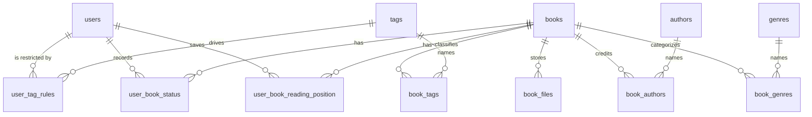

# Delb's data model

The [SQL migrations](../../.drizzle/migrations) define Delb's SQLite schema and upgrades, starting from the `0000_initial.sql` baseline. The separate [Calibre schema reference](reference/calibre-schema.md) describes an import source, not Delb's tables.

## Shared library and access

`books` holds shared metadata, including title, description, publication fields, page count, publisher, series, cover pointer, and optional creator/import provenance. Its author, genre, tag, identifier, and file records are separate tables.

Every book belongs to the one shared library; there is no owning account or collection. Separate entries can represent the same title and retain independent files and reading data. `created_by_user_id` and `added_by_user_id` are provenance only.

`users.role` (`owner`, `admin`, `editor`, or `reader`) governs book mutations. `user_tag_rules` holds an account's `allow` and `block` rules against shared tags. The `visible_books(user_id, book_id)` view applies those rules, and every book query joins it. Owners and admins see every book. See the [library access reference](reference/library-access.md).

The pre-1.0 migration `0022_single_library`, now folded into the `0000_initial.sql` baseline, removed the earlier `collections`, `collection_members`, `collection_books`, and `legacy_collection_books` objects and `books.collection_id`. See [Upgrade to a single library](../hosting/single-library-upgrade.md).

## Records scoped to a reader

| Table                        | Scope and purpose                                                                      |
| ---------------------------- | -------------------------------------------------------------------------------------- |
| `user_book_status`           | One user/book status with start, finish, DNF dates, and optional To be read rank       |
| `user_book_reading_position` | One user/book location, progress, and reader-session sequence                          |
| `user_book_preferences`      | User/book options, including reader-to-history progress sync                           |
| `user_book_progress_log`     | Historical entries with source, percentage, optional page, and occurrence date         |
| `book_ratings`               | One user/book rating on the integer half-star scale, 1 through 10                      |
| `user_book_rationale`        | One private plain-text TBR rationale per reader/book, retained independently of status |
| `user_book_reviews`          | One private review per reader/book, with a spoiler flag                                |
| `book_notes`                 | Private notes per reader/book; a book can have several                                 |
| `personal_shelves`           | Lightweight private named book lists owned by a reader (`personal_shelf_books`)        |

Visual bookshelf arrangements for the library (`scope_kind = 'library'`, `scope_id = 'main'`) and personal shelves (`scope_kind = 'personal'`) are stored on demand in one unified `bookshelf_layouts` table (`scope_kind`, `scope_id`, `revision`, `layout`), and decorative images live in `shelf_picture_assets` keyed by the same scope. Physical spine dimensions (`book_shelf_dimensions`) stay shared on the book entry.

The same shared book can have different statuses, positions, ratings, rationale, and history for different users. Current endpoints select the authenticated user's records.

## Accounts and settings

Delb's Go auth package ([`internal/auth`](../../internal/auth/store.go)) uses the `users`, `sessions`, `accounts`, and `verifications` tables. `users.role` holds the server role.

`user_settings` stores a JSON account document and a millisecond revision timestamp. That document includes desktop settings and an optional mobile override profile. `global_settings` stores installation-wide settings. `global_secrets` stores server-side credentials such as the Hardcover token and optional Google Books API key; settings responses expose availability rather than the secret values.

`system_state` records completed initialization such as the owner-bootstrap claim. Avoid interpreting an empty user list as permission to rewrite that durable bootstrap history.

## Files and operation decisions

`book_files` stores file format, relative path, and file metadata. Bytes live under `library/`. Cover files (`cover.webp` and `cover.source.<ext>`), bookshelf spine artwork (`spine.webp` and `spine.source.<ext>` referenced from `book_spines`), and dedicated mini-cover spines (`mini-spine.webp` and `mini-spine.source.<ext>` referenced from `book_mini_covers`) live in the same book folder next to the cover, even when the book has no downloadable ebook. On startup (when auto-migration is enabled), Delb extracts any legacy base64 spine rows from `book_spines` into book-folder files, clears the base64 columns, and compacts the database with `VACUUM`.

`book_mini_covers` also stores per-book mini-cover studio settings independently of `book_spines`, so saving or editing a printable mini cover does not overwrite the bookshelf spine.

`storage_operations` stores durable operation decisions alongside the database mutation. Filesystem journals preserve the associated staged/original paths. Operation IDs connect the database decision to recovery work. These records and `.delb-*` directories are part of consistency handling, not disposable caches.

Read [storage recovery](../hosting/storage-recovery.md) before changing file deletion or cleanup. Back up the database and library together.

## Useful constraints

| Constraint                                                                   | Effect                                                                                |
| ---------------------------------------------------------------------------- | ------------------------------------------------------------------------------------- |
| Unique user email                                                            | An email address identifies one account                                               |
| `user_tag_rules` primary key and mode check                                  | An account has at most one rule, `allow` or `block`, per tag                          |
| `user_tag_rules.tag_id` restricts tag deletion                               | A tag that a visibility rule uses cannot be deleted                                   |
| Unique non-null Calibre book ID                                              | Calibre re-import can identify an existing Delb book                                  |
| Unique user/book status, position, preference, rating, review, and rationale | Personal values remain separate across readers                                        |
| Unique book/identifier type                                                  | An identifier type has one value per book; cross-book duplicates still need detection |

Foreign-key cascades and explicit mutation logic remove related rows. They do not automatically remove ebook bytes. File deletion requires the storage operation path.
