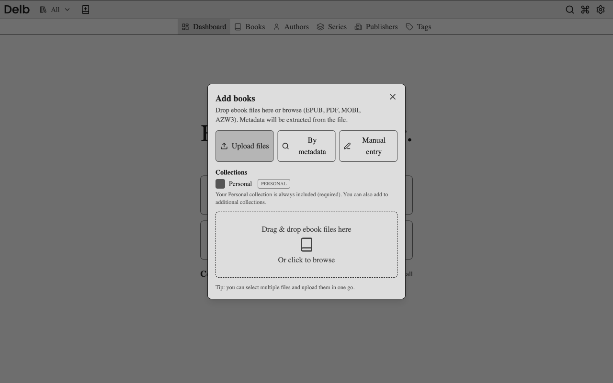

# Add books

Sign in before adding a book. You need owner or editor access to every collection you select as a target.

Open **Add book** in the header. The dialog has **Upload files**, **By metadata**, and **Manual entry** modes. Your Personal collection remains selected. You can also select additional collections.

## Upload ebook files

1. Select **Upload files**.
2. Drop files into the upload area, or browse for EPUB, PDF, MOBI, or AZW3 files.
3. Check the selected collections.
4. Select **Upload**.

Delb extracts the available metadata and stores the files in its managed library. A successful result appears in the dialog and the book becomes available in the selected collections. Extraction varies by format; review the details after import.

Uploads run sequentially in the dialog. Check each file's result when uploading several files. A successful HTTP response for a batch can still contain an individual file failure.

## Add a book from metadata

This mode needs outbound access to an enabled metadata provider. Google Books uses a public API. Hardcover requires an administrator-configured token.

1. Select **By metadata**.
2. Enter an ISBN, title, or author query.
3. Select **Add top result** to accept the best match, or **Search results** to choose a result.
4. Review the imported book details.

This creates a catalog entry, not a downloadable ebook. A downloaded cover does not count as an ebook file. The Add book flow imports the selected record as a whole. The editor's metadata search supports selecting individual fields.

## Enter a book manually

1. Select **Manual entry**.
2. Check the target collections and open the blank editor.
3. Enter at least a title and an author.
4. Select **Create**.

The entry is created when you select Create. The dialog describes this as saving, but the blank editor's button is labeled Create. Leaving the blank editor before submission does not create a book. A manual entry can represent a physical book without an ebook file.

## Resolve a possible duplicate

For a metadata import, choose an existing candidate before using **Add existing to collections** or **Replace selected**. Replacement requires system administrator or owner privileges. **Add new entry** creates another catalog entry. **Cancel** leaves the pending import unapplied.

For an upload, review the candidates and choose the offered skip, upload-anyway, or replacement action. Replacement is privileged. Read the result before retrying a failed file operation.

Adding an existing book to a collection shares the same catalog record. It does not create independent metadata or transfer creator permissions.

If collections fail to load or a selected target is no longer editable, correct the target selection before retrying. For storage errors after an interrupted operation, use the [storage recovery guide](../storage-recovery.md).

Continue with [finding books](find-books.md). See [ingestion request flows](../developing/core-workflows.md#add-a-book) and the [metadata reference](../metadata-fetcher.md) for backend behavior.
