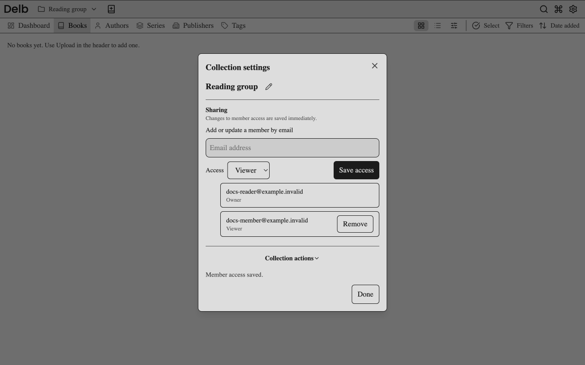

# Organize and share collections

Sign in before managing collections. To share with another reader, that reader needs an existing Delb account.

## Create a collection

1. Open the collection picker in the header.
2. Select **Create collection**.
3. Enter a name and create it.

You become that collection's owner. Your Personal collection remains your default Add book target.

## Add or remove a book

1. Open a book's detail page.
2. Open its collection controls.
3. Add the book to collections you can edit, or remove it from an editable non-Personal collection.
4. Save the membership changes.

The same book can appear in several collections. Removing it from one collection does not delete the catalog record or ebook files. Personal membership cannot be removed through these controls.

For bulk collection changes, select books while browsing a specific collection you own or edit. Open the collection action and choose the target memberships. The bulk endpoint requires an editable source collection and editable targets. The **All** view does not provide a scope-wide bulk collection operation.

## Share a collection

1. Open the collection picker.
2. Select **Collection settings** beside a non-Personal collection you own or edit.
3. Enter the reader's email address in **Add or update a member by email**.
4. Choose **Viewer** or **Editor** and select **Save access**.

Member access saves immediately. Viewers can read the collection. Editors can also rename it, manage book membership, and manage other members. An editor can share the collection further. Choose Viewer when that additional control is unnecessary.

## Leave, transfer, or delete a collection

Open **Collection settings** for the collection, then choose the appropriate action and complete its confirmation.

- As a viewer or editor, choose **Leave collection** to remove your membership. Another owner or editor must add you again to restore it.
- As owner, choose **Transfer ownership** and enter the new owner's email. The recipient becomes the sole owner and you become an editor.
- As owner, choose **Delete collection** and type the collection's name to confirm. Delb removes the collection and its links; the books remain.

Personal collections cannot be shared, transferred, left, or deleted.

If you keep a shared book in another collection you can access, removing access to the original shared collection does not revoke that other link. Delb evaluates visibility through any accessible collection. See the [current access rules](../developing/reference/collections.md#visibility-after-re-sharing).

Book deletion is a separate action with creator or system administrator authorization. Deleting a book affects every collection containing that book.

Continue with [reading and progress](reading.md). See the [permissions reference](../developing/reference/collections.md) and [collection request flows](../developing/core-workflows.md#collections-and-sharing).
