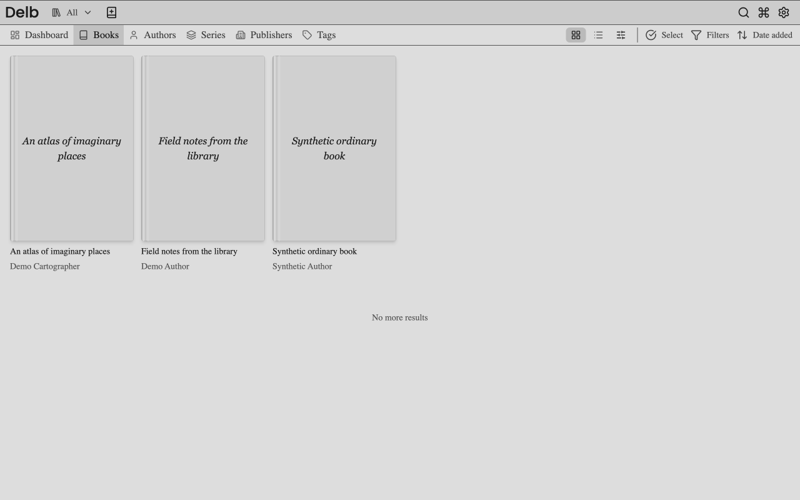

# Browse and find books

Sign in and select a collection in the header. Choose **All** to include books from every collection you can access.

## Browse the catalog

1. Select **Books**, **Authors**, **Series**, **Publishers**, or **Tags** in the navigation.
2. Open a book or an entity to see its available books.
3. In book grids and lists, use the sort control to choose an order.

Book grids and lists support title, page count, publication date, and date-added sorting in either direction. Entity book lists keep the selected collection scope. The separate series presentation has its own layout.

## Search across the library

1. Select **Open global search** in the header.
2. Enter a title, author, series, publisher, tag, or stored ISBN.
3. Select a result to open it.

Global search uses book visibility across your accessible collections. Do not assume the header's selected collection narrows every search result. Search is distinct from the command palette, which performs application actions and changes settings.

## Filter the Books view

Open **Filters** and enter text in **Filter by title** to narrow the current Books view as you type. The title filter works with the selected collection and other filters in both grid and list views. Clear the text to restore those results. While the title filter is active, select books individually for bulk actions.

Open the Books filter controls to narrow by reading status, date added, file presence, or physical and audiobook copy marks. Status filters use your personal status, including **No status**. Copy filters use shared marks; **Not marked** does not mean no copy exists. Dashboard status totals also link to filtered Books views.

Select **All books** on the dashboard to clear status, date-added, file-presence, and copy filters. Your sort order, grid or list choice, view settings, and selected collection stay the same.

Clear applied filters when a book seems to be missing. Then check the collection picker. Empty results can mean no matching books, an empty collection, or lost access to a shared collection.

The sidebar's shelf, tag multi-select, and rating controls marked **coming soon** are disabled placeholders. They are not active filters.

## Arrange your bookshelf

Select **Bookshelf View** in the Books view switcher to see all books you can access. Your bookshelf is personal. Collection and book filters dim nonmatching books without moving them.

Select the pencil button (**Edit shelves**) to move books, drag a shelf handle to change its height, or drag the side handle to change the whole bookcase width. A bookcase cannot be narrower than its books. Select a book to change its displayed size. Pull an upright book down to lay it flat when there is room. To add a book to a stack, drag it onto the center of a sideways spine. Slide a sideways book along the shelf to keep it flat. Lift it to stand it upright. Use the stack handle to move the whole stack.

Use a shelf's options menu to add a shelf or remove an empty one. The bookshelf menu adds a bookcase to the right. In edit mode, drag a bookcase by its top handle to change its order, or focus that handle and use the left and right arrow keys. Select the pencil button again (**Done editing shelves**) to lock the arrangement.

Bookcases sit on one continuous floor. Hold the right mouse button or hold Space and drag to move freely around the view. On a touch screen, swipe to move around. Select **Center bookshelf** to return to the starting position. Use the zoom controls, scroll wheel, or a two-finger pinch to change the display size without changing book dimensions. Scroll-wheel zoom centers on the pointer. Hold Shift while using the scroll wheel to move vertically. The question-mark button in the shelf toolbar shows these navigation tips.

Delb saves your arrangement to your account. If a save fails, use **Retry save**. If another device has a newer arrangement, choose **Load newer arrangement** to discard your unsaved changes and load it. Books without spine artwork use a colored title and author placeholder.

To add spine artwork, open a book and select **Edit book details**. Under **Spine artwork**, upload an image, adjust the crop and optional stretch, and select **Save**. Delb keeps the original upload so you can adjust it later. The spine appears to the left of the cover on the book detail page and on the bookshelf. Collection owners and editors can change or remove it; the artwork is shared with people who can access the book.

## Change the grid or list

1. Use the grid/list switch in the book view.
2. Open the adjacent view-settings button.
3. Choose the fields to show and change their order.

Changes apply immediately and save through your account settings. Grid and list preferences are independent. Covers remain visible even when you hide all metadata fields. Grid cards omit missing values. List cells show a dash for missing values and limit long content to three lines.

Open book details to read a full description or other truncated values. If a separate mobile profile is enabled, mobile field choices can differ from desktop choices.

Continue with [collections](collections.md). See [browse and search request flows](../developing/core-workflows.md#browse-and-search), [view preferences](../developing/reference/library-layout.md#navigation-and-book-views), and [settings synchronization](../developing/reference/settings.md).
