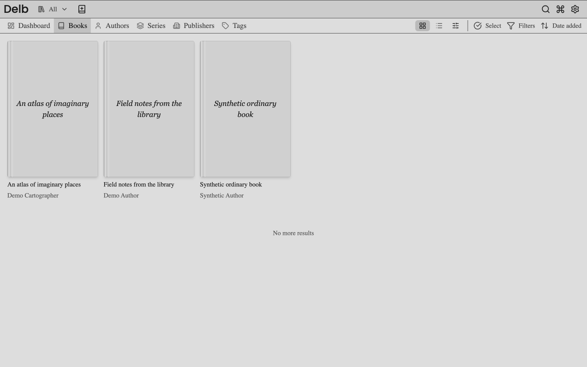

# Browse and find books

Sign in and select a collection in the header. Choose **All** to include books from every collection you can access.

## Browse the catalog

1. Select **Books**, **Authors**, **Series**, **Publishers**, or **Tags** in the navigation.
2. Open a book or an entity to see its available books.
3. In book grids and lists, use the sort control to choose an order.

Book grids and lists support title, page count, publication date, and date-added sorting in either direction. Entity book lists keep the selected collection scope. The separate series presentation has its own layout.

## Search across the library

1. Select **Open global search** in the header.
2. Enter a title, author, series, publisher, tag, or stored ISBN.
3. Select a result to open it.

Global search uses book visibility across your accessible collections. Do not assume the header's selected collection narrows every search result. Search is distinct from the command palette, which performs application actions and changes settings.

## Filter the Books view

Open the Books filter controls to narrow by reading status, date added, or whether an ebook file is present. Status filters use your personal status, including **No status**. Dashboard status totals also link to filtered Books views.

Select **All books** on the dashboard to clear status, date-added, and file-presence filters. Your sort order, grid or list choice, view settings, and selected collection stay the same.

Clear applied filters when a book seems to be missing. Then check the collection picker. Empty results can mean no matching books, an empty collection, or lost access to a shared collection.

The sidebar's shelf, tag multi-select, and rating controls marked **coming soon** are disabled placeholders. They are not active filters.

## Change the grid or list

1. Use the grid/list switch in the book view.
2. Open the adjacent view-settings button.
3. Choose the fields to show and change their order.

Changes apply immediately and save through your account settings. Grid and list preferences are independent. Covers remain visible even when you hide all metadata fields. Grid cards omit missing values. List cells show a dash for missing values and limit long content to three lines.

Open book details to read a full description or other truncated values. If a separate mobile profile is enabled, mobile field choices can differ from desktop choices.

Continue with [collections](collections.md). See [browse and search request flows](../developing/core-workflows.md#browse-and-search), [view preferences](../developing/reference/library-layout.md#navigation-and-book-views), and [settings synchronization](../developing/reference/settings.md).
