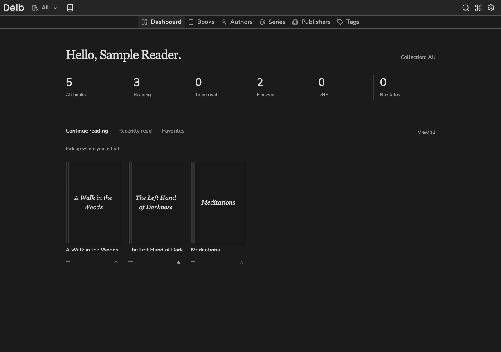

# Create an account and find your library

You need a running Delb installation and its URL. For a local demonstration with synthetic books, follow the [contributor setup](../developing/README.md#run-the-synthetic-demo).

## Create an account

1. Open Delb. An installation with no users redirects you to **Register**.
2. Enter your name, email address, password, and matching password confirmation. The current minimum password length is six characters.
3. Select **Register**.

Delb signs you in and opens the dashboard. On a fresh installation, the first successful bootstrap claimant becomes the system owner. Subsequent self-registrations create normal users. Registration can be closed by an administrator after initial setup.

If registration is closed, ask the installation administrator to create your account. Collection sharing uses an existing account's email address; adding a collection member does not send an invitation email.

## Find your library

1. Open the collection picker beside **Delb** in the header.
2. Select **Personal** to see your default collection, or **All** to include every collection you can access.
3. Select **Books** in the navigation to browse books in that scope.

Your Personal collection starts empty. Delb includes it when you add books through the Add book interface. You can rename it, but you cannot share or delete it.

**All** includes books in shared collections where you are a member. It does not expose every book stored on the installation.

## Choose a dashboard shelf

1. Select **Delb** to open the dashboard.
2. Choose **Continue reading**, **Recently read**, or **Favorites** above the books.
3. Select **Show more** when more books are available.

Continue reading shows your saved progress. Recently read shows finished books with a date read, newest first. Favorites shows books you have starred. The counts above the tabs always describe your selected collection.

To save a favorite, open a book and select its star. Select the filled star again to remove the favorite. Dashboard books also have a star beside their progress or date. Your favorites do not change another reader's favorites, status, or ratings.

See the [dashboard reference](../developing/reference/dashboard.md) for shelf order and data rules.

## Sign in again

Open `/login`, enter your email and password, and select **Login**. Delb restores your account settings after sign-in.

If a form reports an error, correct the named field and submit again. A failed registration does not establish that an account or usable session exists.

Continue with [adding books](add-books.md). For the implementation behind registration and Personal collections, read [account initialization](../developing/core-workflows.md#account-initialization).
