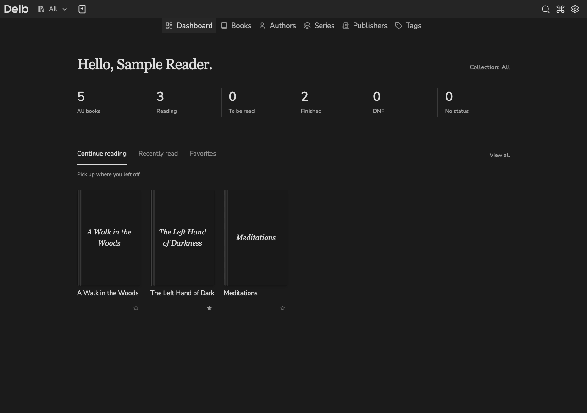

# Create an account and find your library

You need a running Delb installation and its URL. For a local demonstration with synthetic books, follow the [contributor setup](../developing/README.md#run-the-synthetic-demo).

## Create an account

1. Open Delb. An installation with no users redirects you to **Register**.
2. Enter your name, email address, password, and matching password confirmation. The current minimum password length is six characters.
3. Select **Register**.

Delb signs you in and opens the dashboard. On a fresh installation, the first successful bootstrap claimant becomes the system owner. Subsequent self-registrations create normal users. Registration can be closed by an administrator after initial setup.

If registration is closed, ask the installation administrator to create your account. Collection sharing uses an existing account's email address; adding a collection member does not send an invitation email.

## Find your library

1. Open the collection picker beside **Delb** in the header.
2. Select the shared **Default** collection, or **All** to include every collection you can access.
3. Select **Books** in the navigation to browse books in that scope.

New users join the shared default as editors. It can already contain books. You can also create private collections, and you may leave every collection.

**All** includes books in shared collections where you are a member. It does not expose every book stored on the installation.

## Use the dashboard

Select **Delb** to open the dashboard. It describes the collection selected in the header.

- The **All books** card shows your total, covers of recently added books, and a link for each reading status. Select **Browse all books** to open every book with filters cleared.
- **Continue reading** shows your latest logged progress or saved reader percentage. Right-click or long-press a cover to change its reading status.
- **Reading status** has a tile for each status. To be read opens your ranked queue; the others open the Books view filtered to that status.
- **Your shelves** has a tile for each personal shelf and a **New shelf** tile.

Each tile's **⋯** menu changes its card art: Collage, Fan, Stack, Shelf, Pile, or Wall. The All books card's **⋯** menu switches between Wall and Pile. A Pile shows a random handful of the list's books each time the page loads, and you can drag them around. **Pile size** in **Appearance → Dashboard** sets how many books each pile holds, up to 250, and **Pour speed** sets how quickly they pour in. **Appearance → Dashboard** sets these defaults, turns the status bar on the All books card on or off, and can make the Wall drift slowly upward through your covers.

See the [dashboard reference](../developing/reference/dashboard.md) for list order and data rules.

## Sign in again

Open `/login`, enter your email and password, and select **Login**. Delb restores your account settings after sign-in.

If a form reports an error, correct the named field and submit again. A failed registration does not establish that an account or usable session exists.

## Change appearance from the command palette

1. Press **Command+Shift+P** on a Mac or **Ctrl+Shift+P** on another computer.
2. Search for a setting, such as **reading status badges**, **contrast**, or **system dark theme**.
3. Select a result to change it. Search results include settings inside groups and show the group name.

The palette also opens the custom theme editor and the grid and list field-order controls. Changes use the active device profile and save like changes in **Settings → Appearance**.

## Adjust interface contrast

1. Open **Settings → Appearance**.
2. Move **Contrast** below 100% to soften text and borders, or above 100% to strengthen them.
3. Select **Reset contrast to 100%** to restore the original theme.

Changes save automatically. When separate mobile settings are enabled, the slider changes the active device profile. See the [contrast reference](../developing/reference/settings.md#interface-contrast) for the text and border behavior.

Continue with [adding books](add-books.md). For the implementation behind registration and the shared default, read [account initialization](../developing/core-workflows.md#account-initialization).
