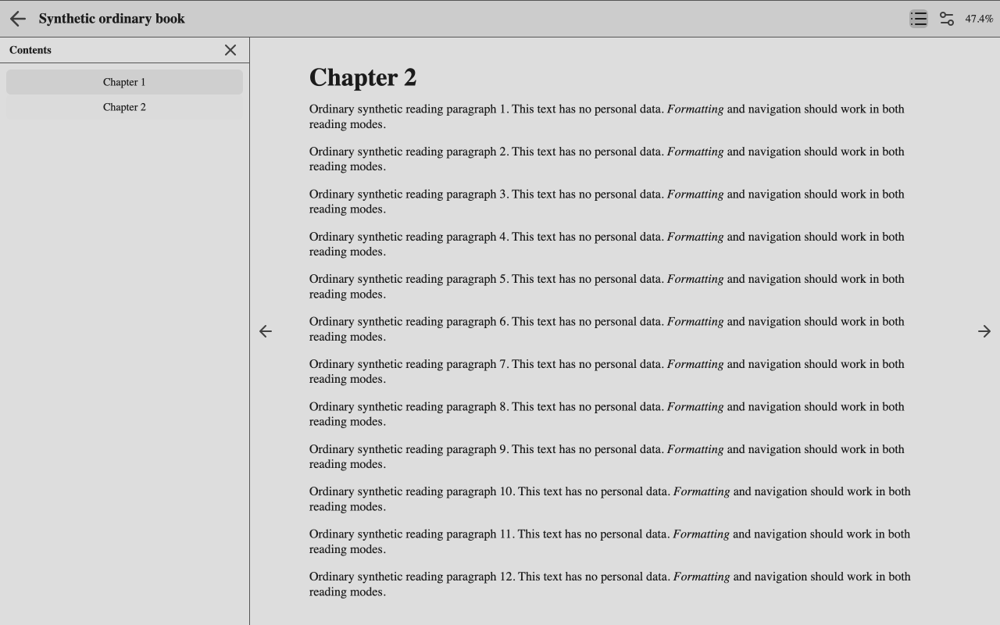
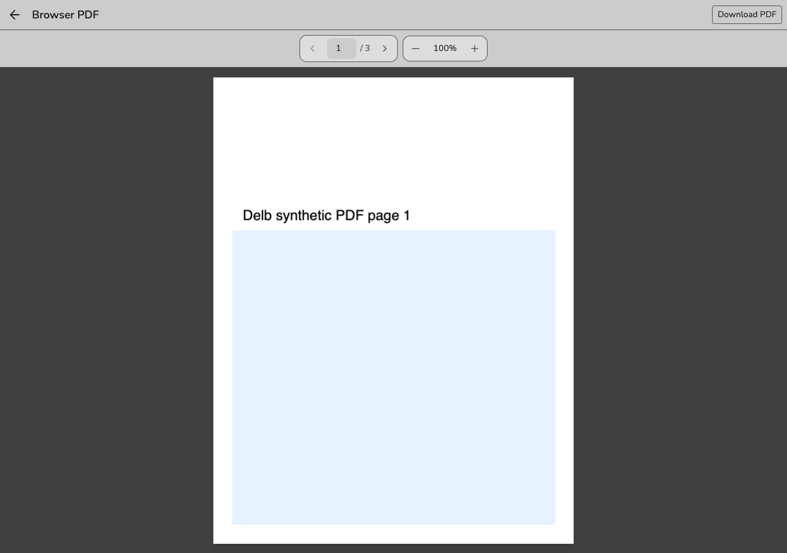

# Read books and track progress

Sign in and open a visible book's detail page. Reading status, ratings, reviews, notes, position, and progress belong to your account, even when the book is shared.

## Read an EPUB

1. Open a book with an EPUB file.
2. Select **Read book**.
3. Use previous/next controls or the left/right arrow keys to turn pages.
4. Open the table of contents to jump to a chapter.
5. Close reader settings or the table of contents if open, then press Escape to return to book details.

The reader restores your saved position and saves subsequent location changes. Use its controls to change the reading mode, font, and appearance.

For MOBI or AZW3, use **Download book** and an appropriate external reader. A reference-only entry has no file to read or download.

## Read a PDF

1. Open a book with a PDF file and select **Read book**. If the book also has an EPUB, select **Read PDF**.
2. Use the previous/next controls, left/right arrows, or page-number field to navigate.
3. Choose **Fit page** or a zoom level. Enlarged pages can be scrolled.
4. Select the back arrow or press Escape to return to book details.

The PDF reader saves your page for your account and restores it when you return. Progress sync uses the displayed page divided by the PDF's actual page count; when enabled, the latest logged percentage can also select the opening page. Replacing the file starts at page 1 unless progress sync supplies a position. A book has one saved position, so switching between EPUB and PDF replaces that position.

Scroll continuously between pages, use the page controls to jump, and use the plus and minus buttons to adjust zoom. Select the zoom percentage to return to fit page. Text selection, search, annotations, interactive forms, and password-protected files are not supported. **Download PDF** opens the existing download flow for use in another reader. See the [PDF reader reference](../developing/reference/pdf-reader.md) for file access and persistence details.

## Mark available copies

On the book details page, select **Physical** or **Audiobook** under **Copies**. Editors and Admins can change these marks. Everyone who can see the book sees the same marks. An unmarked copy does not mean that no copy exists. These marks do not add files or audiobook playback.

To update several books, select them in **Books**, then choose **Actions → Set copies**. For each copy type, choose **Mark available**, **Clear mark**, or **Leave unchanged**, then select **Apply**. Delb reports how many books it skipped because you could not edit them.

To show copy icons on covers, enable **Copy indicators** under **Settings → Appearance → Cover Style**. The setting is personal and starts disabled.

## Set a reading status

1. Open the book detail page.
2. Choose **To be read**, **Reading**, **Finished**, **DNF**, or **No status** under **Status**.
3. Review the dates and edit them if needed.

Choosing Reading, Finished, or DNF fills in today's date for that status: the start date, the finish date, or the stop date. Delb doesn't invent other dates. For example, finishing a book doesn't set a start date. Every date is optional. Select the clear button next to a date to remove it, and the status stays the same. This is useful when you don't remember when you started or finished a book.

To enter a date, type it or choose it from the calendar. Delb saves the date when you leave the field, press Enter, or pause after completing it. If you leave a date half typed, the field goes back to the saved date.

Finished with a finish date creates a 100% progress entry on that date. DNF records a stop date without creating a progress entry. Returning to To be read clears the reading dates. Clearing status removes the status record.

To change status while browsing, right-click a book cover and open **Reading status**. Choose a status or **No status** to clear it. A check marks your current choice. This works in grid and list views, including books without ebook files. Exit bulk selection mode to use the cover menu.

The menu closes after a successful save. The book's status updates in place, preserving your scroll position and loaded pages. A book leaves a filtered view if its new status no longer matches. Other loaded books stay in place. If saving fails, the menu shows an error and lets you retry.

To show status icons on covers, enable **Reading status badges** under **Settings → Appearance → Cover Style**. Badges start disabled. A bookmark means To be read, an open book means Reading, a check means Finished, and a circle-slash means DNF. Books with no status have no badge. Badges use your theme's accent color.

Changes affect your account's status, not anyone else's. See [status and date rules](../developing/reference/reading-status-progress.md) for the complete transitions.

## Share a book

Open any book detail page and select the **Share** button in the action bar to copy a link, export a reading status card, or build a printable mini book cover.

### Copy a link

Select **Share → Copy link** to copy the URL for that book in your library. Only accounts that already have access to the book can open the link.

### Export a reading status card

A reading status card is an image of a book with its cover and your reading details for posting outside Delb. It works for any reading status—Finished, Currently reading, To be read, DNF, or unset—and adjusts its headline and available toggles to match what you have recorded.

1. Open a book and select **Share → Reading status card**. When you choose **Finished** for a book, a notice also offers **Share card**.
2. Choose a **Style**: **Cover palette**, **Editorial split**, **Swiss grid**, **Duotone**, or **Pace overlay**. Most styles take their colors from the cover.
3. Choose a **Format**: **Square** for posts, **Story** for full-screen stories, or **Landscape** for link-style posts.
4. For **Pace overlay**, choose a **Background**. **Theme** uses your Delb theme, **Soft cover** uses a blurred copy of the cover, and **Transparent** leaves the background empty so that you can place the image over your own photo.
5. Under **Show**, clear anything that you want to leave off. Unavailable items for your current status—such as finish pace on a To be read book—are disabled with an explanation.
6. Select **Download PNG**, **Copy image**, or **Share**. **Copy image** and **Share** appear only when your browser supports them.

The card shows only details that you recorded. For **Currently reading** and **DNF**, it can include your latest progress percentage, reading days, and a pace chart once you have logged progress on at least three different days. The card never includes a link to your library, your review, or your notes.

To stop the notice after you finish a book, select **Don't ask again** in it. To turn it back on, use **Offer a share card when I finish a book** under **Settings → General → Share cards**. See the [share cards reference](../developing/reference/share-cards.md) for how stats and colors are calculated.

### Create a mini book cover

A mini book cover is a printable flat wrap sized for a 20 × 10 × 30 mm miniature book (20 × 30 mm left cover, 10 × 30 mm spine in a 1:3 aspect ratio, and 20 × 30 mm right cover—50 × 30 mm flat). A book's saved mini cover spine and print settings are stored separately from the book's bookshelf spine so that changes in the mini cover studio never alter the spine shown on your library pages.

1. Open a book and select **Share → Mini book cover**.
2. Preview the flat wrap or switch to **3D Folded** to inspect how the panels fold around a book block. Toggle **Guides** or **Actual size** in the preview toolbar as needed.
3. Adjust the **Spine**:
   - Choose a source: **Mini spine** (the book's saved 1:3 mini spine, when one exists), **Book spine** (the book's bookshelf spine, used as a starting point), **Uploaded**, **Generated**, or **Plain** for a clean type-only spine.
   - Delb checks whether the current spine matches 1:3 and warns if it is off-ratio.
   - When the ratio differs, choose **Crop** (and drag the spine in the preview to reposition it), **Fit**, or **Stretch**.
   - Select **Upload spine image** to use a custom spine image, or use **Make a 1:3 spine** (when ChatGPT image generation is connected) to regenerate a 1:3 spine from the current spine and trim it with the 1:3 crop box.
   - Editors and Admins can select **Save mini spine & settings** to store the dedicated mini spine and print settings on the book (without changing the bookshelf spine), **Save settings** to save only the layout and export options, or **Remove saved mini spine** to clear the saved mini spine while keeping the saved settings.
4. Under **Covers**, choose whether the back panel uses the **Same cover**, a solid **Cover color**, or a **Blurred** cover, and optionally flip the orientation for right-to-left books.
5. Under **Export PNG**, choose **Standard (300 dpi)** or **High (600 dpi)**, optional **Bleed** (0, 1, or 2 mm), **Fold ticks**, and **Corner trim marks**, then select **Download PNG** or **Copy image**.

Print the downloaded PNG at **100% / Actual size** (turn off "Fit to page"). The PNG embeds physical DPI metadata so print software sizes it to 50 × 30 mm automatically. The image never includes a link to your library.

## Write a review and keep notes

The book detail page has a **Review** and a **Notes** section under **Rating**. Only you can see them.

1. Select **Write a review**, or select your existing review to edit it.
2. Select **Contains spoilers** if the review reveals the plot. Delb then hides the review until you select **Show review with spoilers**.
3. Select **Save**. To remove the review, clear the text and save.

A book has one review per reader and can have several notes. Select **Add a private note** to add one. Each note has **Edit** and **Delete** links. A note is a good place for details such as who borrowed the book. If saving fails, the editor keeps your draft for retry.

To bring reviews and notes from Goodreads, see [import from Goodreads](import-goodreads.md).

## Order your To be read queue

1. Select **To be read** in the view menu, or select the dashboard's **To be read** tile.
2. Drag a book's handle with a mouse or touch, or use its up and down arrows.
3. Click **Add rationale** or an existing rationale to edit it on the page.
4. Select **Save** to keep the note or **Cancel** to discard the edit.

Your private queue includes every queued book that you can see. Rank 1 is the book you most want to read. A book that an administrator later hides from you leaves the queue. If it becomes visible again, it returns at the end of the queue.

Book details show the same rationale and offer numeric rank entry for longer moves. A rationale remains after you start, finish, or remove a book from TBR. Clear the text and save to remove the rationale. If saving fails, the editor keeps your draft for retry.

New and re-added books join the end. A book leaves the queue when you lose all access to it. If access returns while its status is still To be read, it rejoins at the end with its rationale preserved.

## Log progress

1. Find the progress log controls on the book detail page.
2. Enter a percentage, or a page number when the book has a page count.
3. Submit the progress entry and check the history.

A manual entry records reading history. With Progress sync disabled, it does not change the saved reading position. With Progress sync enabled, reopening the reader can restore from the latest logged percentage: after EPUB locations finish generating, or by selecting the corresponding PDF page.

To connect reader activity with the history, enable **Progress sync** for this book. It starts disabled. The enabled reader can append progress entries and use the latest logged percentage during restoration. Saving a reader position remains separate from opting into progress-history sync.

If another reader opens the shared book, their saved position and history are independent of yours. If saving fails, keep the page open long enough to inspect the error before assuming another device has the new position.

See [reader request flows](../developing/core-workflows.md#reading-and-personal-data) and the [EPUB reference](../developing/reference/epub-reader.md) for persistence and request ordering.
