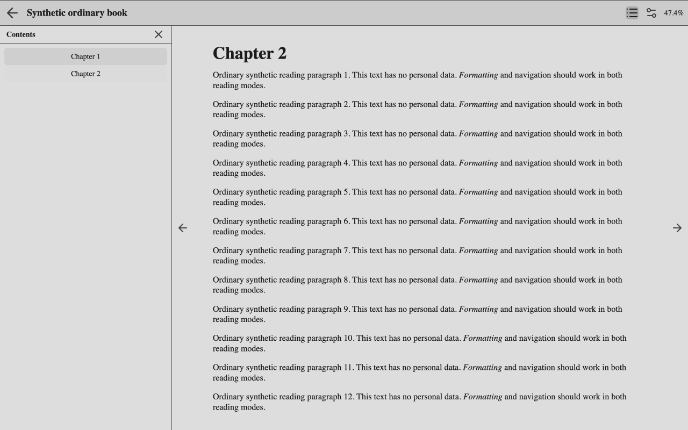
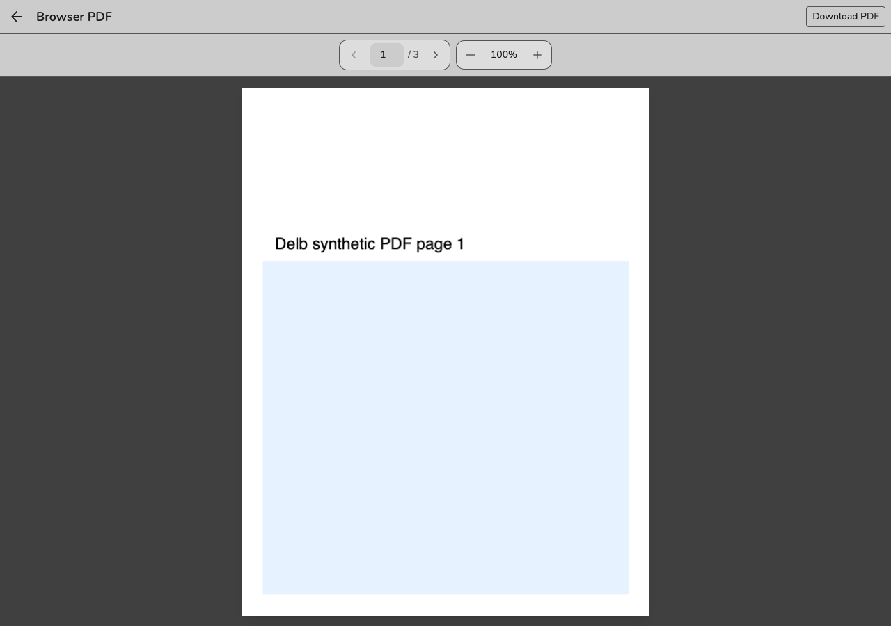

# Read books and track progress

Sign in and open a visible book's detail page. Reading status, ratings, position, and progress belong to your account, even when the book is shared.

## Read an EPUB

1. Open a book with an EPUB file.
2. Select **Read book**.
3. Use previous/next controls or the left/right arrow keys to turn pages.
4. Open the table of contents to jump to a chapter.
5. Close reader settings or the table of contents if open, then press Escape to return to book details.

The reader restores your saved position and saves subsequent location changes. Use its controls to change the reading mode, font, and appearance.

For MOBI or AZW3, use **Download book** and an appropriate external reader. A reference-only entry has no file to read or download.

## Read a PDF

1. Open a book with a PDF file and select **Read book**. If the book also has an EPUB, select **Read PDF**.
2. Use the previous/next controls, left/right arrows, or page-number field to navigate.
3. Choose **Fit page** or a zoom level. Enlarged pages can be scrolled.
4. Select the back arrow or press Escape to return to book details.

The PDF reader saves your page for your account and restores it when you return. Progress sync uses the displayed page divided by the PDF's actual page count; when enabled, the latest logged percentage can also select the opening page. Replacing the file starts at page 1 unless progress sync supplies a position. A book has one saved position, so switching between EPUB and PDF replaces that position.

This is a basic page viewer. Text selection, search, annotations, interactive forms, and password-protected files are not supported. **Download PDF** opens the existing download flow for use in another reader. See the [PDF reader reference](../developing/reference/pdf-reader.md) for file access and persistence details.

## Mark available copies

On the book details page, select **Physical** or **Audiobook** under **Copies**. Collection owners and editors can change these marks. Everyone who can access the book sees the same marks. An unmarked copy does not mean that no copy exists. These marks do not add files or audiobook playback.

To update several books, select them in **Books**, then choose **Actions → Set copies**. For each copy type, choose **Mark available**, **Clear mark**, or **Leave unchanged**, then select **Apply**. Delb reports how many books it skipped because you could not edit them.

To show copy icons on covers, enable **Copy indicators** under **Settings → Appearance → Cover Style**. The setting is personal and starts disabled.

## Set a reading status

1. Open the book detail page.
2. Choose **To be read**, **Reading**, **Finished**, **DNF**, or **No status** under **Status**.
3. Review the dates that Delb fills in and edit them if needed.

Setting Reading fills a missing start date. Finished fills a finish date and creates a 100% progress entry. DNF records a stop date without creating a progress entry. Returning to To be read clears the reading dates. Clearing status removes the status record.

To change status while browsing, right-click a book cover and open **Reading status**. Choose a status or **No status** to clear it. A check marks your current choice. This works in grid and list views, including books without ebook files. Exit bulk selection mode to use the cover menu.

The menu closes after a successful save. The book's status updates in place, preserving your scroll position and loaded pages. A book leaves a filtered view if its new status no longer matches. Other loaded books stay in place. If saving fails, the menu shows an error and lets you retry.

To show status icons on covers, enable **Reading status badges** under **Settings → Appearance → Cover Style**. Badges start disabled. A bookmark means To be read, an open book means Reading, a check means Finished, and a circle-slash means DNF. Books with no status have no badge. Badges use your theme's accent color.

Changes affect your account's status, not the status of other collection members. See [status and date rules](../developing/reference/reading-status-progress.md) for the complete transitions.

## Order your To be read queue

1. Select **To be read** in the view menu or on the dashboard.
2. Drag a book's handle with a mouse or touch, or use its up and down arrows.
3. Click **Add rationale** or an existing rationale to edit it on the page.
4. Select **Save** to keep the note or **Cancel** to discard the edit.

Your private queue includes books from every collection you can access. Rank 1 is the book you most want to read. The dashboard's To be read count always covers this full queue, regardless of the selected collection.

Book details show the same rationale and offer numeric rank entry for longer moves. A rationale remains after you start, finish, or remove a book from TBR. Clear the text and save to remove the rationale. If saving fails, the editor keeps your draft for retry.

New and re-added books join the end. A book leaves the queue when you lose all access to it. If access returns while its status is still To be read, it rejoins at the end with its rationale preserved.

## Log progress

1. Find the progress log controls on the book detail page.
2. Enter a percentage, or a page number when the book has a page count.
3. Submit the progress entry and check the history.

A manual entry records reading history. With Progress sync disabled, it does not change the saved reading position. With Progress sync enabled, reopening the reader can restore from the latest logged percentage: after EPUB locations finish generating, or by selecting the corresponding PDF page.

To connect reader activity with the history, enable **Progress sync** for this book. It starts disabled. The enabled reader can append progress entries and use the latest logged percentage during restoration. Saving a reader position remains separate from opting into progress-history sync.

If another reader opens the shared book, their saved position and history are independent of yours. If saving fails, keep the page open long enough to inspect the error before assuming another device has the new position.

See [reader request flows](../developing/core-workflows.md#reading-and-personal-data) and the [EPUB reference](../developing/reference/epub-reader.md) for persistence and request ordering.
